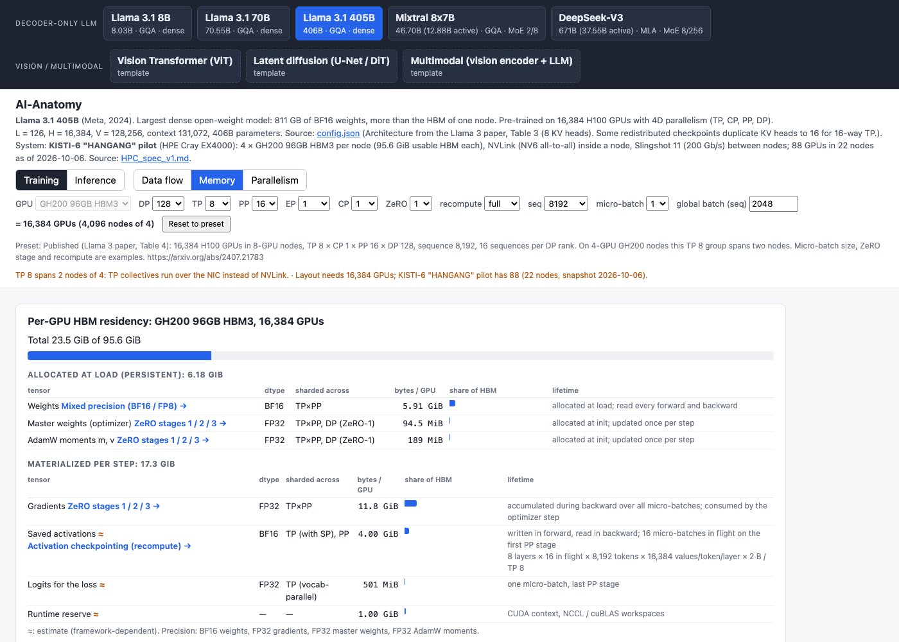
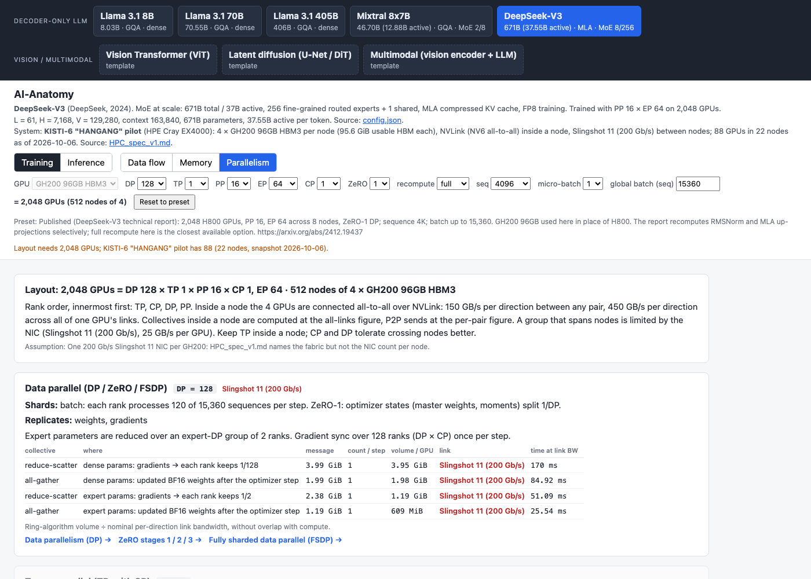
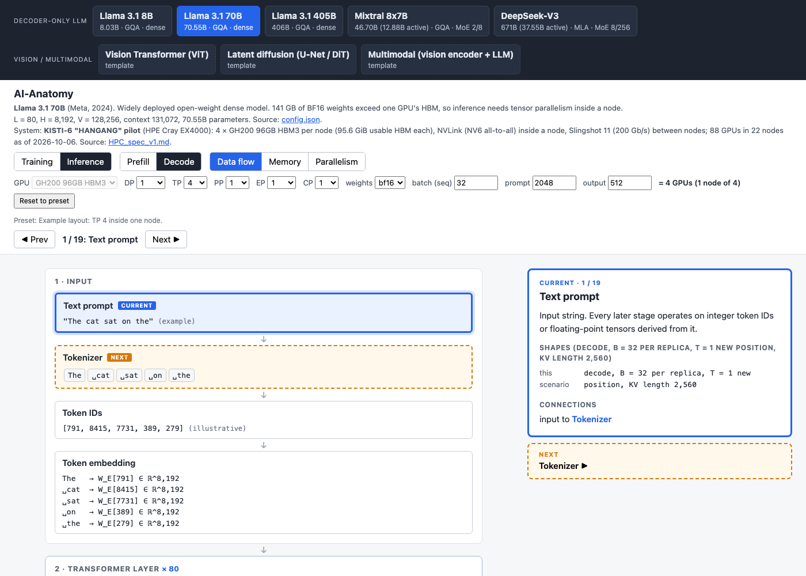

---
# A case study. The lines below "---" fill the box at the top of the page.
# Every field is optional; lines starting with # are comments.
title: AI-Anatomy
# summary: shown under the title, on the homepage and in feeds.
summary: A web page that computes what each GPU holds, where the data goes and what every collective costs when an open LLM is trained or served on NVIDIA GH200 nodes. Every number comes from published model configs and a measured hardware specification.
# date: the date used to sort this entry in "Latest" (YYYY-MM-DD).
date: 2026-10-06
period: September–October 2026
stack: HTML, CSS and JavaScript; no build step and no libraries
# links: "Label | URL" pairs separated by ";".
# When GitHub Pages is on for the AI-Anatomy repository, put this first:
#   Live page | https://baekcheolkim.github.io/AI-Anatomy/ ;
links: Repository | https://github.com/BaekCheolKim/AI-Anatomy
---

## What it answers

Choose a model, a phase (training, or inference split into prefill and decode) and a parallel layout. The page answers three questions about that setup:

- **Memory:** what does each GPU hold, and how much of its HBM does that take?
- **Data flow:** what happens at each stage between the input text and the next token, with which tensor shapes, and where do those tensors reside?
- **Parallelism:** which collectives does the layout need, how many bytes does each GPU send, over which link, and how long does that take at the link's bandwidth?

Each of the five models is included for a specific technique or scale:

| Model | Included for |
|---|---|
| Llama 3.1 8B | Dense GQA decoder; its 16 GB of BF16 weights fit on one GPU |
| Llama 3.1 70B | 141 GB of BF16 weights, so inference needs tensor parallelism inside a node |
| Llama 3.1 405B | The largest dense open-weight model, 811 GB in BF16, pre-trained with 4D parallelism on 16,384 GPUs |
| Mixtral 8x7B | Coarse-grained mixture of experts: 8 experts, top-2 routing |
| DeepSeek-V3 | Mixture of experts at scale: 671B parameters in total, 37B active, 256 routed experts and 1 shared; MLA compresses the KV cache |

Every model opens with a training preset and an inference preset. A preset taken from a paper cites it; the others are marked as examples. The URL holds the whole view, so a copied link reopens the same model, phase, layout and stage.

## Three examples

### Memory: Llama 3.1 405B pre-training

With the layout from the Llama 3 paper (TP 8 × PP 16 × DP 128 on 16,384 GPUs), each GPU holds 23.5 GiB of its 95.6 GiB. 6.18 GiB is allocated at load: the BF16 weights (5.91 GiB) and the ZeRO-1 shards of the FP32 master weights and AdamW moments. 17.3 GiB is materialized during each step, most of it FP32 gradients (11.8 GiB).

The page also flags a problem with moving this layout to GH200. The paper used nodes of 8 GPUs; a GH200 node has 4, so each TP 8 group spans two nodes, and its tensor-parallel collectives would run over the network instead of NVLink.

### Parallelism: DeepSeek-V3 pre-training

The DeepSeek-V3 report trained on 2,048 GPUs with PP 16, EP 64 and ZeRO-1 data parallelism. The page lists every collective of that layout with its message size, count per step, volume per GPU, link and time. For example, the data-parallel reduce-scatter of the dense parameters' gradients sends 3.95 GiB from each GPU per step. At the 25 GB/s that each GPU gets over Slingshot 11, that takes 170 ms.

### Data flow: Llama 3.1 70B decode

One decode step of Llama 3.1 70B with TP 4 on one 4-GPU node, in 19 stages from the text prompt to the choice of the next token. Prev and Next step through the stages. For each stage, the side panel gives the operation, the tensor shapes for the chosen batch and lengths, where the data resides, and the collectives.

## How the numbers are computed

Every formula is in one file, `calc.js`; no number on the page is typed in by hand.

- **Parameters** are counted matrix by matrix from each model's published `config.json`. The totals match the published counts: 8,030,261,248 for Llama 3.1 8B, and 671.0B in total with 37.6B active for DeepSeek-V3.
- **Training memory** assumes BF16 weights, FP32 gradients, FP32 master weights and FP32 AdamW moments (BF16 moments for DeepSeek-V3, as in its report). ZeRO-1, 2 and 3 shard the optimizer states, then the gradients, then the weights across the data-parallel group. Saved activations are counted per token per layer, assuming FlashAttention and sequence parallelism.
- **Inference memory** is the weights in the chosen precision plus the KV cache, split by KV head across TP ranks. MLA's compressed latent is replicated across TP ranks.
- **Collective volumes** use ring-algorithm factors: an all-reduce sends 2(n−1)/n of the tensor from each GPU; all-gather, reduce-scatter and all-to-all send (n−1)/n. A group inside one node uses NVLink; a group that spans nodes uses the network.
- **Prefill and decode time** is max(FLOPs ÷ peak, bytes ÷ HBM bandwidth), which shows whether each phase is compute-bound or bandwidth-bound.

The hardware is the NVIDIA GH200 96GB node of the KISTI-6 "HANGANG" pilot system (HPE Cray EX4000): 4 GPUs per node, 97,871 MiB of usable HBM per GPU, NVLink between the GPUs of a node (450 GB/s per direction per GPU), and Slingshot 11 between nodes (25 GB/s per GPU). Measured values come from the system's hardware specification; the others come from NVIDIA's GH200 datasheet.

## Limits

- Times are lower bounds: they assume peak throughput, nominal link bandwidth, and no overlap of compute and communication.
- Activation sizes and the runtime reserve are estimates, marked ≈ on the page.
- The expert-parallel all-to-all volume counts every routed token copy separately, which overstates the traffic of node-limited routing.

## Not written yet

- The technique pages behind links such as "ZeRO stages →" have section headings only.
- Vision Transformer, latent diffusion and multimodal models are listed as outlines, without configs or numbers.

Fig. 1 on the [homepage](../../index.html) uses the same inference-memory formulas.
