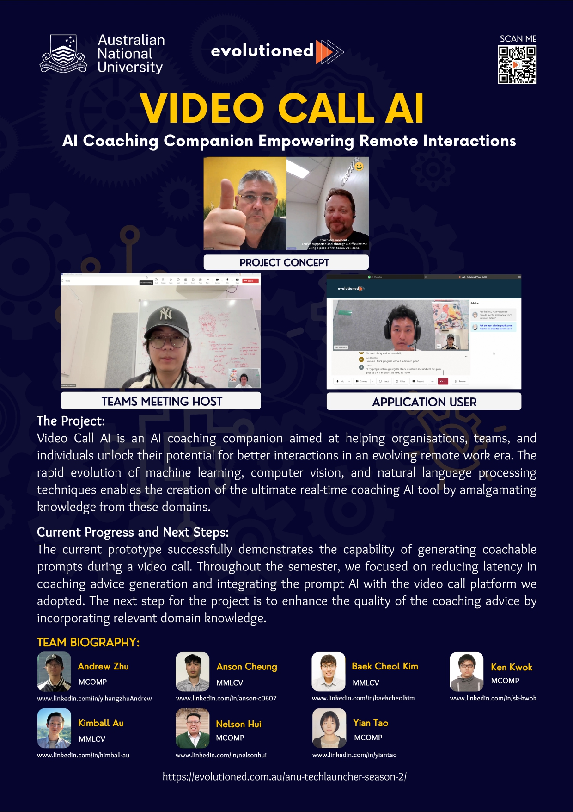

---
# A case study. The lines between the two "---" fill the box at the top of the page:
# summary, period, role, team, stack and links ("Label | URL" pairs separated by ";").
# Every field is optional; lines starting with # are comments.
# date: the date used to sort this entry in "Latest" (YYYY-MM-DD).
title: Video Call AI
summary: A prototype that turns the live captions of a video call into coaching prompts for its participants, built on Azure Communication Services and Azure OpenAI.
date: 2025-01-27
team: Seven students in ANU TechLauncher, working with Evolutioned Pty Ltd
stack: TypeScript, Node.js, Azure Communication Services, Python, Flask, Azure OpenAI, GitHub Actions
links: Statement of work | https://drive.google.com/file/d/16n2vd1aOY1eGbfnfABO5Is-Y0BlR0hyF/view?usp=drive_link ; ANU TechLauncher | https://comp.anu.edu.au/TechLauncher/
---

<!-- Add before publishing: your own part of the work (add `role:` above), the project period
     (add `period:` above), and measured prompt latency before and after the optimization,
     if you have the numbers. -->

## Problem

Participants in a video call get no guidance while the conversation is happening. Video Call AI reads the conversation as it happens and shows each participant coaching advice.

## What we built

Two services on Azure App Service:

- **Video call app** (TypeScript and Node.js): creates a meeting, lets participants join from an invitation link and turns on live captions. Calls run through Azure Communication Services, which also connects a host who joins from Microsoft Teams.
- **Prompt service** (Python and Flask): receives the transcribed text of each conversation segment, sends it with a prompt to an Azure OpenAI deployment and returns the advice to the call app. It keeps a summarized history of the conversation and handles segments on separate threads as they arrive.

The prompts are stored outside the code, so the advice can be adapted to a specific domain. GitHub Actions runs the CI/CD pipelines.

## Result

The result is a working prototype: participants in a live call receive coaching prompts generated from the captions of each conversation segment. The second iteration returns advice with lower latency than the first proof of concept.

## Not built

Planned but not implemented: emotion detection from video and audio, retrieval-augmented generation to add domain knowledge to the prompts, and speaker tracking to segment the conversation by participant.

